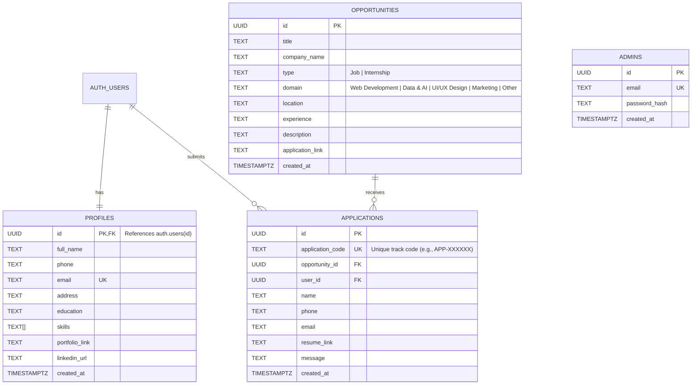

# Database Schema Documentation

## 1. Overview
The database for the **Internship & Job Listing Portal** is implemented in PostgreSQL (hosted on Supabase). It uses relational integrity, foreign key cascades, unique constraints to prevent duplicate applications, and Row Level Security (RLS) policies for user data privacy.

---

## 2. Entity-Relationship Diagram (ERD)

---

## 3. Table Definitions

### 3.1 `opportunities`
Stores job and internship postings created and managed by administrators.

| Column | Type | Constraints | Description |
|---|---|---|---|
| `id` | `UUID` | `PRIMARY KEY DEFAULT gen_random_uuid()` | Unique opportunity identifier |
| `title` | `TEXT` | `NOT NULL` | Job or internship title (indexed for search) |
| `company_name` | `TEXT` | `NOT NULL` | Hiring company name |
| `type` | `TEXT` | `NOT NULL CHECK (type IN ('Job', 'Internship'))` | Posting category |
| `domain` | `TEXT` | `NOT NULL CHECK (domain IN ('Web Development', 'Data & AI', 'UI/UX Design', 'Marketing', 'Other'))` | Technical domain (indexed) |
| `location` | `TEXT` | `NOT NULL` | Location (e.g., Remote, On-site, City) |
| `experience` | `TEXT` | `NOT NULL` | Required experience level |
| `description` | `TEXT` | `NOT NULL` | Full role description and requirements |
| `application_link` | `TEXT` | `NOT NULL` | Official direct external application URL |
| `created_at` | `TIMESTAMPTZ` | `DEFAULT now()` | Timestamp of listing creation |

**Indexes:**
- `idx_opportunities_title`: GIN index using `gin_trgm_ops` for fast case-insensitive title search.
- `idx_opportunities_domain`: B-Tree index for domain filtering dropdown.

---

### 3.2 `applications`
Stores candidate applications submitted through the in-app application form.

| Column | Type | Constraints | Description |
|---|---|---|---|
| `id` | `UUID` | `PRIMARY KEY DEFAULT gen_random_uuid()` | Internal unique row identifier |
| `application_code` | `TEXT` | `NOT NULL UNIQUE` | Human-friendly tracking identifier (format: `APP-XXXXXX`) |
| `opportunity_id` | `UUID` | `NOT NULL REFERENCES opportunities(id) ON DELETE CASCADE` | Linked opportunity posting |
| `user_id` | `UUID` | `REFERENCES auth.users(id) ON DELETE CASCADE` | Authenticated applicant user ID |
| `name` | `TEXT` | `NOT NULL` | Applicant full name |
| `phone` | `TEXT` | `NOT NULL` | Applicant contact phone number |
| `email` | `TEXT` | `NOT NULL` | Applicant email address |
| `resume_link` | `TEXT` | `NULLABLE` | URL to uploaded PDF resume in storage |
| `message` | `TEXT` | `NULLABLE` | Cover letter / short note from candidate |
| `created_at` | `TIMESTAMPTZ` | `DEFAULT now()` | Submission timestamp |

**Key Constraints:**
- `UNIQUE (user_id, opportunity_id)`: Prevents candidates from applying more than once to the same opportunity.

---

### 3.3 `profiles`
Stores profile information for registered candidate accounts.

| Column | Type | Constraints | Description |
|---|---|---|---|
| `id` | `UUID` | `PRIMARY KEY REFERENCES auth.users(id) ON DELETE CASCADE` | Supabase Auth user ID |
| `full_name` | `TEXT` | `NULLABLE` | Candidate display name |
| `phone` | `TEXT` | `NULLABLE` | Candidate phone number |
| `email` | `TEXT` | `NOT NULL UNIQUE` | Candidate email address |
| `address` | `TEXT` | `NULLABLE` | Candidate location / city |
| `education` | `TEXT` | `NULLABLE` | Candidate degree / university |
| `skills` | `TEXT[]` | `NULLABLE` | Array of skill tags |
| `portfolio_link` | `TEXT` | `NULLABLE` | Link to portfolio / personal website |
| `linkedin_url` | `TEXT` | `NULLABLE` | Link to LinkedIn profile |
| `created_at` | `TIMESTAMPTZ` | `DEFAULT now()` | Account profile creation date |

---

### 3.4 `admins`
Stores administrator credentials for session-based admin access.

| Column | Type | Constraints | Description |
|---|---|---|---|
| `id` | `UUID` | `PRIMARY KEY DEFAULT gen_random_uuid()` | Admin ID |
| `email` | `TEXT` | `NOT NULL UNIQUE` | Admin login email |
| `password_hash` | `TEXT` | `NOT NULL` | Bcrypt password hash |
| `created_at` | `TIMESTAMPTZ` | `DEFAULT now()` | Creation timestamp |

---

## 4. Security & Access Control Policies (RLS)

1. **`opportunities` Table:**
   - **Public / Candidates (SELECT):** Unrestricted read access (`USING (true)`).
   - **Admins (INSERT, UPDATE, DELETE):** Managed via backend Express controller protected with `requireAdmin` session validation and Supabase service-role key.

2. **`applications` Table:**
   - **Candidates:** Can view their own submissions via `auth.uid() = user_id`.
   - **Public Lookup:** Accessible via application code lookup (`/api/applications/public/:applicationId`) via backend service layer.
   - **Admins:** Read-only access to all candidate submissions via `/api/admin/applications`.

3. **Storage (`resumes` bucket):**
   - Service-role proxy upload endpoint (`/api/applications/upload-resume`) verifies authenticated session and returns a secure public URL.

